# MRI Complex Data Denoising Comparison

> 교내 캡스톤 설계 · 5인 팀 팀장 (2025.03 – 2025.06, 13주) · 실험 설계·역할 분담·일정 관리 담당

MRI 원본은 복소수 데이터인데, 보통은 절댓값(magnitude) 영상으로 바꾼 뒤 노이즈를 지웁니다. 이때 위상 정보가 사라지고 노이즈 분포도 Gaussian에서 Rician으로 바뀝니다. 복소수 상태를 유지한 채 MP-PCA를 적용하면 이 손실을 피할 수 있는지 검증했습니다.

## 한눈에 보기

| | |
| --- | --- |
| 실험 설계 | 원본의 노이즈 양을 알 수 없어, GRE MRI(256×224×176×6 echo)에 노이즈 10–50%를 주입한 팬텀으로 통제 조건 구성 |
| 구현 | MP-PCA를 magnitude / 실수·허수 분리 / 복소수-실수 결합 행렬, 세 도메인에 적용. DIPY `localpca`가 음수를 0으로 잘라 위상을 망가뜨리는 부분을 찾아 부호를 보존하도록 수정 |
| 결과 | Rician bias 보정 SNR·SSIM으로 30개 조건(echo 6 × 노이즈 5단계) 평가. 복소수 결합 방식이 대부분 구간에서 최고, 노이즈 50%에서 SNR 최대 260.8% 향상 |
| 한계 확인 | SNR이 가장 높은 결과가 눈으로 보면 구조가 뭉개진 영상이었음. 지표의 한계를 명시하고 위상 기반 평가 지표를 후속 과제로 제안 |
| 팀 운영 | 착수 전 2주간 선행 논문을 나눠 읽고 서로 발표해 이해 수준을 맞춘 뒤 역할 분담, 이후 격주 간이 발표로 진행 공유 |

| Magnitude | Real/Imag split | Complex-concatenated |
| --- | --- | --- |
| 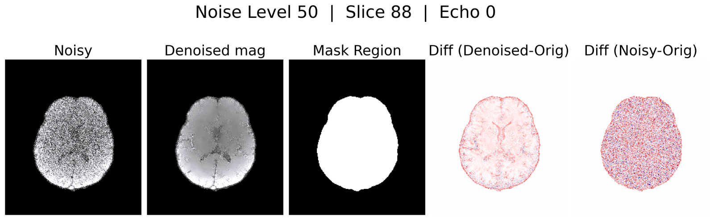 | 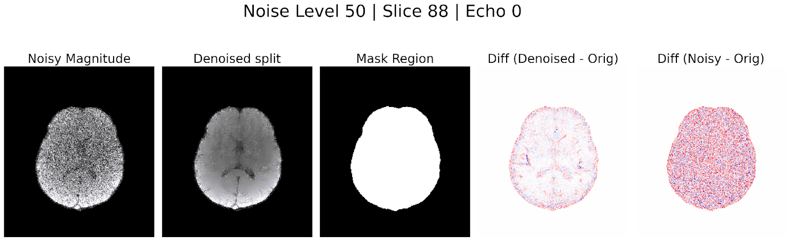 | 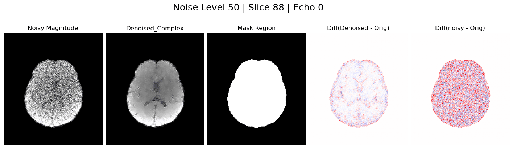 |

<sub>노이즈 50%, slice 88, echo 0. 각 그림의 4번째 칸이 denoising 후 남은 오차(Denoised − Orig), 5번째 칸이 처음 넣은 노이즈(Noisy − Orig)입니다.</sub>

Multi-echo complex MRI 데이터에서 MP-PCA 기반 denoising 전략을 비교한 연구 코드입니다. Magnitude 영상만 사용하는 방식과 real/imaginary 정보를 보존하는 방식을 함께 구현하고, SNR, SSIM, PSNR, NRMSE, HFEN 지표로 성능을 평가했습니다.

## Overview

보고서 기준 데이터는 6 echo를 가진 multi-echo MRI이며, 원본 변수명은 `meas_gre`입니다. 보고서에는 Gradient Echo 기반 MRI라는 표현이 등장하지만, 이 저장소의 핵심 범위는 특정 시퀀스 명칭보다 complex-valued MRI denoising 방법 비교에 있습니다.

- k-space에 IFFT만 적용한 raw 복소수 데이터 `(256, 224, 176, 6)`
- 노이즈: 전체 echo 평균 신호 강도의 10–50%를 σ로 하는 Gaussian 노이즈를 real/imag에 동일하게 추가
- patch radius 2, 3, 4를 모두 돌렸고, 아래 그림과 표는 patch radius 3 (7×7×7) 기준

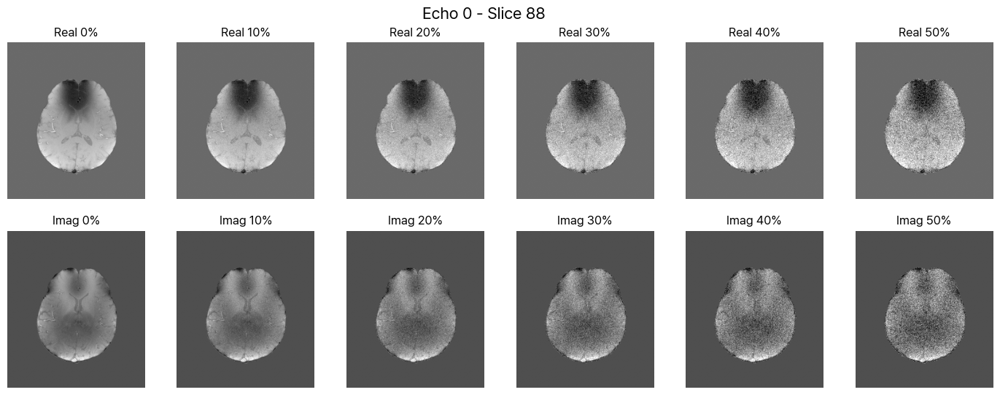

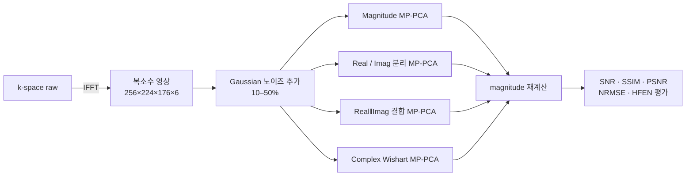

## Methods

- **Magnitude MP-PCA**: 복소수 데이터를 magnitude 영상으로 변환한 뒤 MP-PCA를 적용하는 기준선입니다.
- **Real/Imaginary Split MP-PCA**: 실수부와 허수부에 각각 MP-PCA를 적용해 phase 정보를 보존하려는 접근입니다.
- **Complex-Concatenated MP-PCA**: real/imaginary 성분을 하나의 multi-channel 실수 행렬로 연결해 echo 간 상관 정보를 함께 활용합니다.
- **Complex Wishart Experiments**: Hermitian covariance, 복소수 SVD/eigenvalue decomposition, Complex Wishart 모델을 활용한 실험적 접근입니다.
- **Feature Preservation Post-processing**: denoising 이후 구조와 경계 정보를 보존하기 위한 edge-aware 보정 실험입니다.

### Complex-Concatenated 방식

복소수 패치를 `X = [X_real | X_imag] ∈ ℝ^(M × 2Ne)` 형태로 펼치면, PCA가 같은 echo의 real–imag 상관과 echo 간 상관을 한꺼번에 봅니다. 7×7×7 패치 기준 M = 343, P = 12라서 γ = P/M ≈ 0.035이고, MP 분포의 상한 `λ₊ = σ²(1 + √γ)²`를 안정적으로 쓸 수 있는 범위입니다.

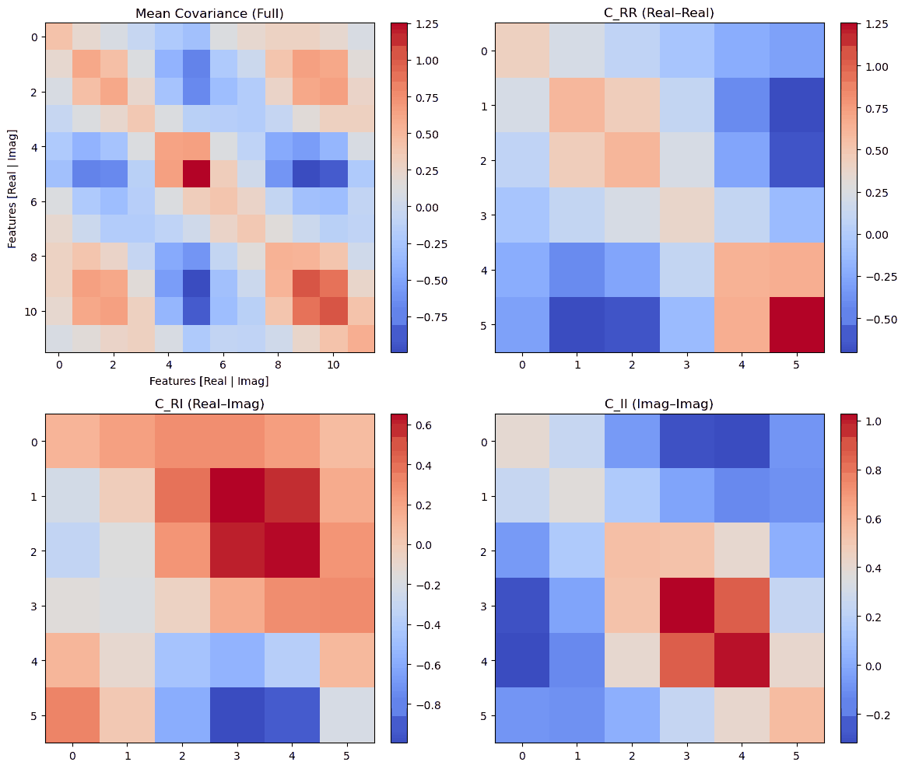

패치 내 공분산을 보면 같은 성분 안에서 인접 echo끼리 상관이 강하게 나타납니다(신호의 시간적 연속성).

```python
multi_ch = np.concatenate([noisy_real, noisy_imag], axis=3)   # (X, Y, Z, 2*Ne)
den_all  = mppca(multi_ch, mask=mask_brain, patch_radius=3, pca_method='svd')
mag_den  = np.abs(den_all[..., :Ne] + 1j * den_all[..., Ne:])
```

### DIPY 수정

DIPY `genpca`는 마지막에 결과를 0 이상으로 clip 합니다. real/imaginary 성분은 음수가 정상 값이라 이 줄을 빼야 부호(위상)가 보존됩니다.

```python
denoised_arr = thetax / theta
# denoised_arr.clip(min=0, out=denoised_arr)   ← 제거
denoised_arr[mask == 0] = 0
```

## Tech Stack

- Python, NumPy, SciPy
- DIPY `localpca`/`mppca` 기반 MP-PCA 구현 수정
- scikit-image metric evaluation
- Matplotlib, Napari
- PCA, SVD, eigenvalue decomposition
- Hermitian covariance, Marcenko-Pastur distribution
- Gaussian noise simulation, Rician bias correction

## Repository Structure

```text
.
├── src/mri_denoising/          # 재사용 가능한 denoising 알고리즘 모듈
├── experiments/                # 실행형 실험, 평가, 시각화 스크립트
├── notebooks/                  # 최종 비교 및 주요 실험 노트북
├── archive/                    # 초기 실험 및 참고용 코드
├── requirements.txt
└── README.md
```

## Key Files

| Path | Description |
| --- | --- |
| `src/mri_denoising/modified_mppca.py` | DIPY local PCA 계열 구현을 복소수 real/imaginary 데이터에 맞게 수정한 핵심 MP-PCA 모듈 |
| `src/mri_denoising/complex_vector_mppca.py` | 복소수 데이터를 real/imaginary vector 형태로 변환해 MP-PCA를 적용하는 실험 모듈 |
| `src/mri_denoising/enhanced_complex_vector_mppca.py` | complex vector MP-PCA의 개선 버전 |
| `src/mri_denoising/final_complex_mppca.py` | 복소수 covariance 기반 최종 실험 모듈 |
| `src/mri_denoising/complex_wishart*.py` | Complex Wishart, Hermitian covariance, eigenvalue 기반 denoising 실험 |
| `src/mri_denoising/feature_preservation.py` | 구조/경계 보존 후처리 실험 |
| `experiments/run_complex_concatenated_comparison.py` | real/imaginary concatenation 방식 실행 및 지표 계산 스크립트 |
| `experiments/test_complex_vector_mppca.py` | complex vector MP-PCA 검증 스크립트 |
| `experiments/view_denoised_results.py` | 저장된 denoising 결과 확인 스크립트 |
| `experiments/visualize_napari_results.py` | Napari 기반 결과 시각화 스크립트 |
| `notebooks/final_comparison.ipynb` | 주요 denoising 방식 비교와 정량 평가가 포함된 최종 실험 노트북 |

## Evaluation

연구에서는 원본 magnitude 영상과 denoised magnitude 영상을 비교해 다음 지표를 계산했습니다.

- `SNR`: Rician bias correction을 적용한 signal-to-noise ratio
- `SSIM`: 구조적 유사도
- `PSNR`: peak signal-to-noise ratio
- `NRMSE`: normalized root mean squared error
- `HFEN`: high frequency error norm

실험 흐름은 노이즈 레벨 10-50% 조건에서 각 denoising 방법을 적용하고, echo별 정량 지표와 diff map 시각화를 비교하는 방식입니다.

## Quick Start

```bash
pip install -r requirements.txt
PYTHONPATH=src python experiments/run_complex_concatenated_comparison.py
```

실행에는 원본 MRI 데이터가 필요합니다. 이 저장소에는 연구 코드와 README용 그림(`docs/images/`)만 포함했으며 `.mat`, `.npy`, `.xlsx`, 기타 결과 이미지, PDF는 제외했습니다.

기본 실행 스크립트는 작업 디렉터리에 다음 파일이 있다고 가정합니다.

- `meas_gre_dir1.mat`
- `noisy_meas_gre_dir1_10.mat`
- `noisy_meas_gre_dir1_20.mat`
- `noisy_meas_gre_dir1_30.mat`
- `noisy_meas_gre_dir1_40.mat`
- `noisy_meas_gre_dir1_50.mat`

## Results Summary

보고서 기준으로 모든 MP-PCA 기반 방식은 노이즈 제거 효과를 보였습니다. Complex-concatenated 방식은 여러 echo와 real/imaginary 성분의 상관 정보를 함께 활용해 일부 조건에서 magnitude 방식보다 높은 지표를 보였고, real/imaginary split 방식은 두 성분 사이의 상관 구조를 충분히 활용하지 못해 상대적으로 제한적인 성능을 보였습니다.

다만 echo가 증가하거나 신호가 약해지는 구간에서는 magnitude 기반 접근이 더 안정적인 경우도 있었기 때문에, 실제 적용에서는 데이터 특성, echo별 신호 강도, phase 보존 필요성을 함께 고려해야 합니다.

### 정량 지표 (노이즈 30%, echo 평균)

SNR은 NEMA 차분 방식으로 노이즈를 추정하고, magnitude 영상의 Rician 편향을 `√(μ² − 2σ²)`로 보정했습니다.

| 방법 | SNR 전 → 후 | ΔSNR | SSIM 전 → 후 | ΔSSIM |
| --- | --- | --- | --- | --- |
| Magnitude | 4.42 → **10.62** | **+6.20** | 0.880 → 0.946 | +0.066 |
| Real/Imag split | 4.42 → 8.93 | +4.51 | 0.880 → 0.932 | +0.052 |
| Complex-concatenated | 4.42 → 10.53 | +6.11 | 0.880 → **0.947** | **+0.067** |

<details>
<summary>echo별 SNR (노이즈 30%)</summary>

| Echo | Noisy | Magnitude | Real/Imag | Complex |
| --- | --- | --- | --- | --- |
| 0 | 5.642 | 11.561 | 10.982 | **12.072** |
| 1 | 5.107 | 12.067 | 10.617 | **12.471** |
| 2 | 4.597 | 11.545 | 9.687 | **11.811** |
| 3 | 4.139 | **10.628** | 8.656 | 10.590 |
| 4 | 3.722 | **9.513** | 7.515 | 8.958 |
| 5 | 3.331 | **8.413** | 6.143 | 7.277 |

</details>

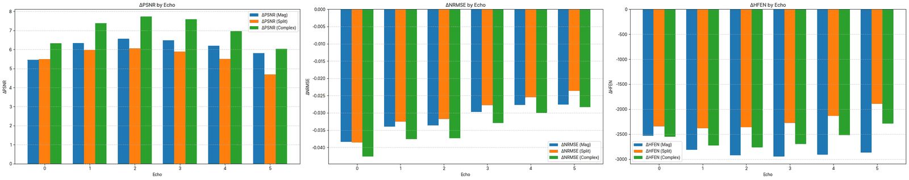

PSNR·NRMSE는 모든 echo에서 complex-concatenated가 가장 좋았고, HFEN(고주파 오차)은 echo 1–5에서 magnitude가 더 많이 줄었습니다.

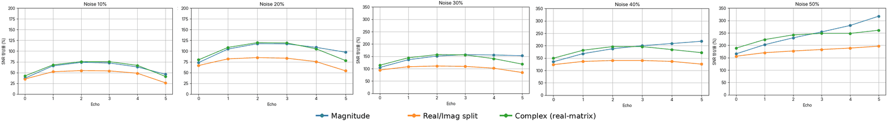

<details>
<summary>노이즈 단계별 SSIM 향상률</summary>

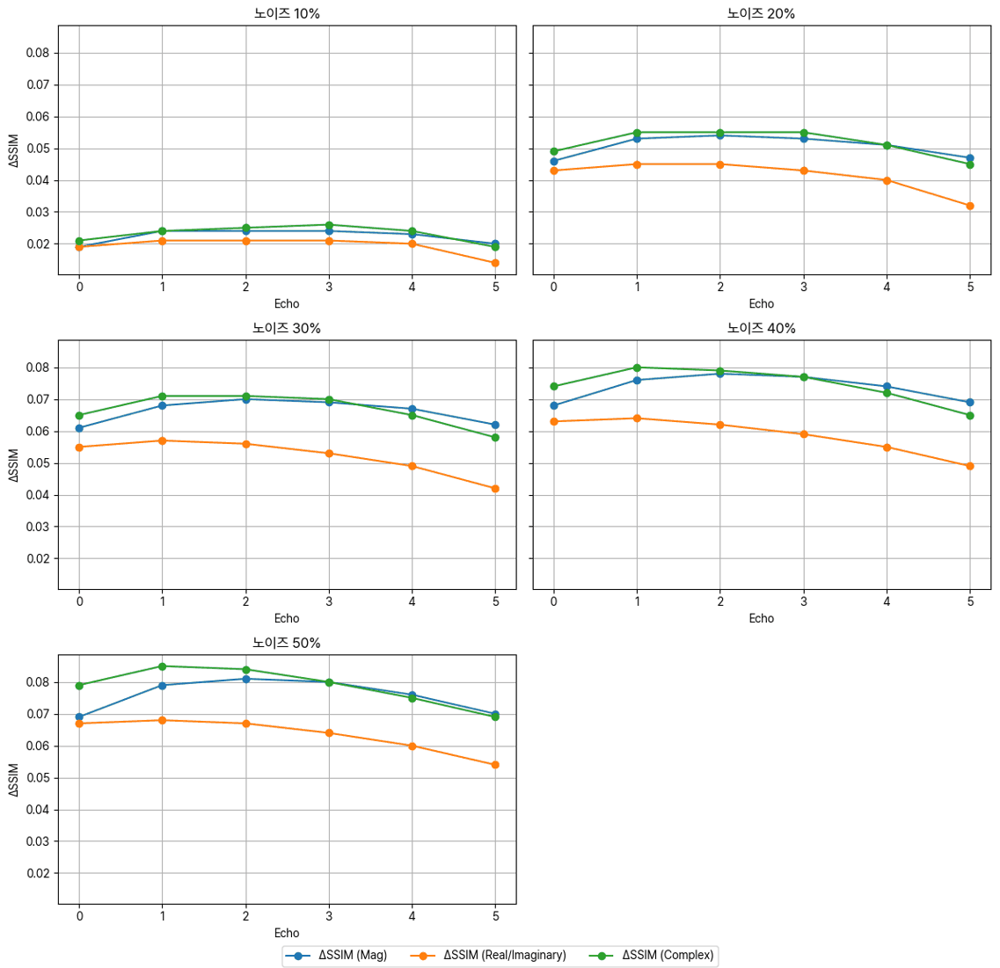

파랑 Magnitude, 주황 Real/Imag split, 초록 Complex

</details>

### echo에 따라 달라지는 결과 (노이즈 30%, slice 88)

앞쪽 echo(위)에서는 두 결과가 거의 비슷하고, 신호가 약해진 마지막 echo(아래)에서는 magnitude 쪽이 더 매끈하게 나옵니다. complex 쪽은 노이즈 질감이 조금 더 남는데, 이 echo에서 SNR이 magnitude보다 낮게 나온 것(8.41 vs 7.28)과 맞아떨어집니다.


<details>
<summary>echo 1–4 전체 보기</summary>

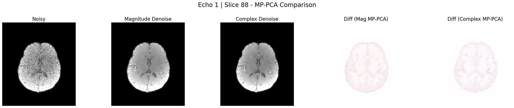


</details>

## 한계와 배운 점

**위상 정렬 없이 real/imag를 나누면 손해다.**
real/imag 양쪽에 MP-PCA를 걸면 위상 안정화가 필요 없을 거라 봤는데, 실제로는 magnitude보다도 낮았습니다. 복셀마다 위상이 제각각이라 real/imag 축으로 자르면 신호가 불연속적으로 쪼개지고, PCA가 잘못된 방향으로 분해하거나 노이즈를 과소평가한 것으로 보고 있습니다. 다음에 한다면 phase alignment 전처리를 먼저 넣을 겁니다.

**SNR만 믿으면 안 된다.**
노이즈 30% 영상을 흐릿하게 만든 결과의 SNR이 12.67로, 구조를 더 잘 살린 magnitude(12.07)·complex(12.47) 결과보다 높게 나왔습니다. 전체적으로 원본과 비슷하기만 하면 디테일을 뭉개도 SNR은 오릅니다.

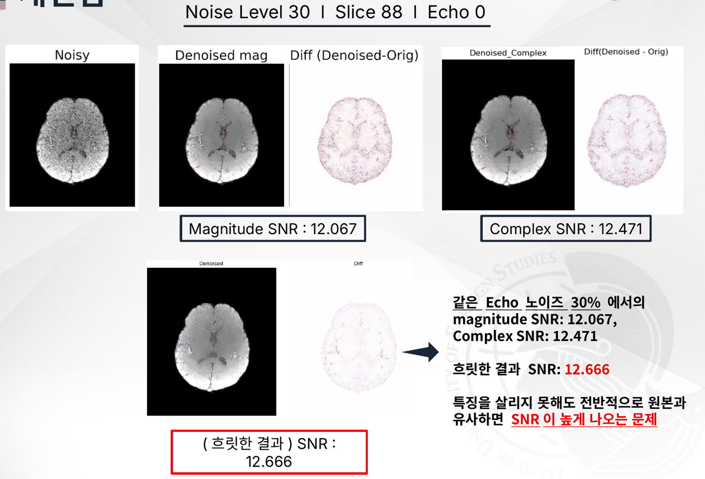

그래서 SNR 하나로 결론 내지 않고 SSIM, PSNR, NRMSE, HFEN과 diff map을 함께 봤습니다.

**실수 행렬 결합은 근사다.**
real/imag를 이어 붙이는 방식은 구현이 간단하지만 복소수 데이터의 통계적 성질을 다 쓰지는 못합니다. 이를 보완하려고 Complex Wishart 분포로 MP 임계값을 직접 잡는 방법(Hermitian 공분산 + Bessel correction)까지 시도했는데, 정량 비교까지 마무리하지는 못했습니다. 아래는 노이즈 30%에서의 중간 결과입니다.

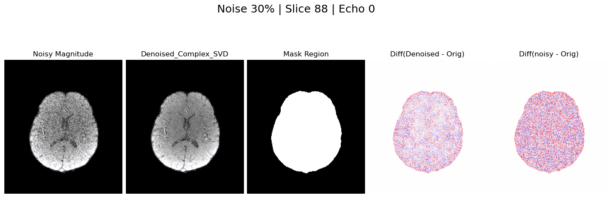

## References

- Veraart, J. et al. (2016). Denoising of diffusion MRI using random matrix theory. *NeuroImage*, 142, 394–406.
- Manjón, J. V. et al. (2013). Diffusion weighted image denoising using overcomplete local PCA. *PLoS ONE*, 8(9).
- Ye, C., Zhang, X., & Liu, Z. (2024). Denoising complex-valued diffusion MR images using a two-step non-local principal component analysis approach. *bioRxiv*. https://doi.org/10.1101/2024.10.30.621081

## Notes

- 연구 데이터와 결과 파일은 용량 및 재배포 문제로 포함하지 않았습니다.
- `archive/`는 초기 실험과 참고 코드 보관용이며, 핵심 구현은 `src/mri_denoising/`와 `experiments/`에 정리했습니다.
- 일부 노트북에는 원래 실험 환경의 출력 로그가 남아 있을 수 있습니다.
